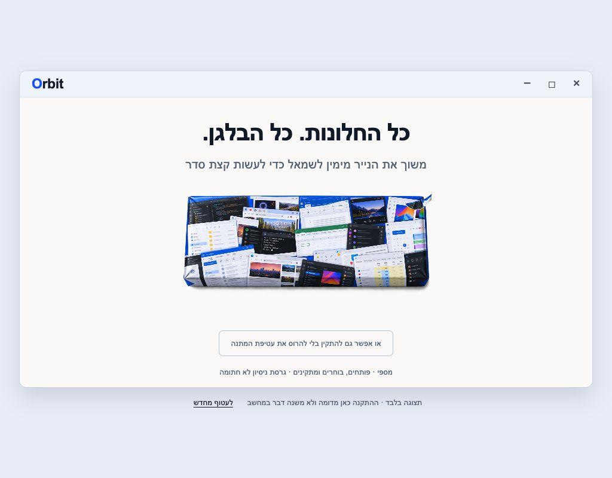
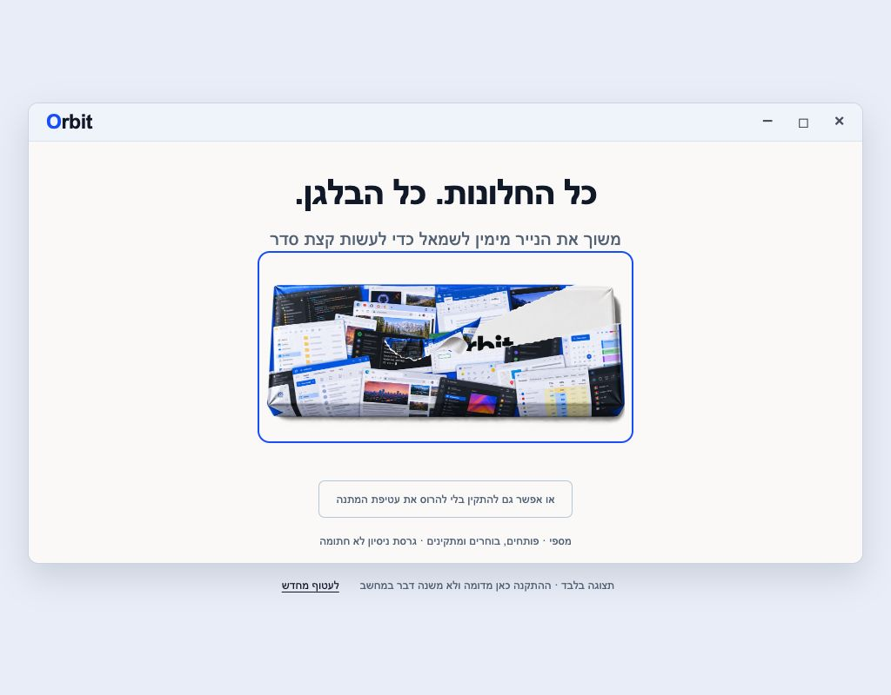
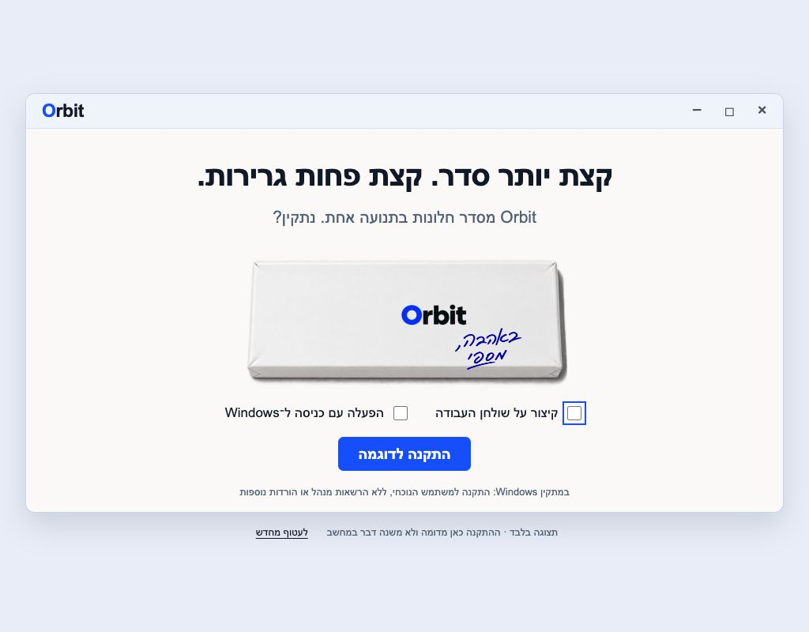
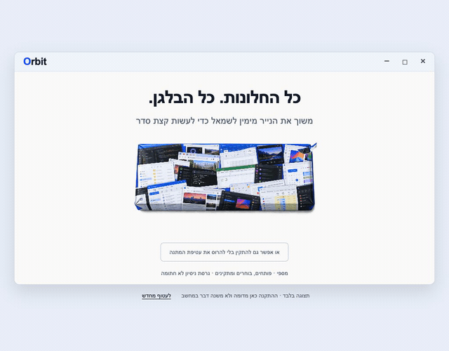

# Orbit for Windows

**Hold. Point. Release. A little less window chaos.**

A native Windows window manager built in Rust. Hold **Right Ctrl**, point toward a layout, and release to arrange the active window. Orbit uses Win32, Direct2D and DirectWrite, with tray settings, multiple displays and undo.

[עברית](README.he.md) · [Download](#download) · [Gift experience](#the-gift-experience) · [Build](#build-from-source) · [Technical details](docs/TECHNICAL.md)

> **0.1.0 development preview · Windows x64 · unsigned.** The downloadable build was cross-compiled on macOS. Core tests, static analysis and binary checks passed; installation and interactive window management still require validation on Windows. See [Windows acceptance checks](WINDOWS-QA.md).

## The gift experience

The installer arrives wrapped in desktop chaos: overlapping document windows, editors, browsers, folders, spreadsheets and terminals. Drag the paper from right to left to reveal a calm white Orbit package and a handwritten **“באהבה, מספי”** — “With love, Seffy.”

The parcel stays compact. The paper tears where you drag, a partial tear can be continued, and a button opens it without tearing. Then choose your optional shortcuts, install, and open Orbit.



| Tear away the chaos | Ready to make some room |
| --- | --- |
|  |  |

### Video

**Full gift-flow browser demonstration, recorded on macOS.** This is a simulation of the wrapper, options, installing state and finish screen; it is not a recording of a real Windows installation. The simulated installing state is extended to six seconds so it can be seen clearly.

https://github.com/user-attachments/assets/e5e479bd-d306-4a9c-98e8-ea516fc62e61

<details>
<summary>Animated preview (GIF)</summary>



</details>

[Watch or download the full MP4](docs/media/Orbit-Install-Preview.mp4) · [All six screenshots](docs/media/)

## Download

| File | Contents |
| --- | --- |
| [Gift installer](downloads/v0.1.0/Orbit-Gift-0.1.0-x64.exe) | One offline Windows installer with the app and artwork embedded |
| [Complete gift package](downloads/v0.1.0/Orbit-Gift-Windows-0.1.0-x64.zip) | Installer, standalone preview, screenshots, video, source snapshot, notices and build report |
| [Portable package](downloads/v0.1.0/Orbit-Windows-x64-preview.zip) | Orbit.exe, install/diagnostic commands and documentation |
| [Source snapshot](downloads/v0.1.0/Orbit-Source.zip) | Full corresponding project source |
| [Offline gift preview](downloads/v0.1.0/Orbit-Gift-Preview.html) | Download and open locally to try the visual flow without installing anything |
| [SHA-256 checksums](downloads/v0.1.0/Orbit-Gift-SHA256SUMS.txt) | Verify the gift download files |

The same files are kept in the repository so the source, media and downloadable build remain together.

## Install and use

1. Download the installer on a Windows x64 computer.
2. Tear the paper, or choose **“או אפשר גם להתקין בלי להרוס את עטיפת המתנה”** to open it without tearing.
3. Choose whether to add a desktop shortcut or start Orbit when signing into Windows. Both choices start unchecked.
4. Select Install, then Open Orbit.
5. Focus a window, hold **Right Ctrl** briefly, move toward the desired layout and release.

Installation is per user in `%LOCALAPPDATA%\Programs\Orbit`; it needs no administrator rights, additional runtime download, account or internet connection. This preview is unsigned, so Windows may show an unknown-publisher warning.

| Control | Action |
| --- | --- |
| Hold Right Ctrl | Open the radial layout menu |
| Left / right | Half-screen placement |
| Corners | Quarter-screen placement |
| Up / down | Maximize / center |
| Mouse wheel | Cycle supported sizes |
| Tab / Shift+Tab | Choose another display |
| Win + Alt + Space | Open the menu for keyboard use |
| Escape | Cancel |
| Win + Alt + Z | Undo the last arrangement |

Open the tray icon for settings, pause/resume and quit. Hold delay, gap, trigger key and sign-in startup are configurable. Full controls, installation, uninstallation and diagnostics are in [Technical details](docs/TECHNICAL.md).

## Build from source

Install Rust **1.93+** with the MSVC toolchain, Visual Studio Build Tools with **Desktop development with C++**, and a Windows SDK.

```powershell
cargo build --locked --release
powershell -NoProfile -File scripts/check.ps1
powershell -NoProfile -File scripts/build-gift.ps1
```

The app is built at `target/release/orbit.exe`. The gift installer is copied to `dist/Orbit-Gift-0.1.0-x64.exe`. The [Windows build workflow](.github/workflows/windows.yml) builds the app and installer, runs the core and gesture tests, and checks the resulting PE files. Automated builds do not replace the interactive acceptance checklist.

## Everything in this repository

- `src/`: geometry, input, settings and native Windows implementation.
- `gift-installer/`: native offline installer, tear gesture, four transparent PNG assets and browser preview.
- `assets/`, `packaging/`, `scripts/`: app icons, manifests, build/package tools and diagnostics.
- `docs/media/`: all six screenshots and the full H.264 video.
- `downloads/v0.1.0/`: the complete downloadable build and source packages, reports and checksums.
- [Artwork notes](gift-installer/ASSETS.md) and [Imagegen prompts](gift-installer/windows-chaos-prompts.json): the wrapping design and how it was made.

The app uses no telemetry or network requests. Its bounded diagnostics record startup/error information, not typed text or window titles. There are no benchmark claims: performance, mixed-DPI behavior and actual Windows installation remain acceptance work.

## License and inspiration

[MIT](LICENSE). Dependency notices are included in [THIRD-PARTY-NOTICES.txt](THIRD-PARTY-NOTICES.txt). Orbit is an independent implementation inspired by the interaction in [mrkai77/Loop](https://github.com/mrkai77/Loop). Loop remains a separate project.
